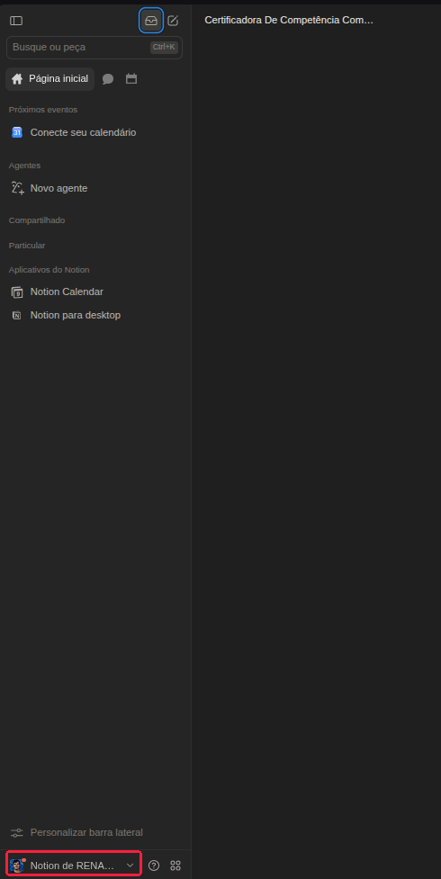
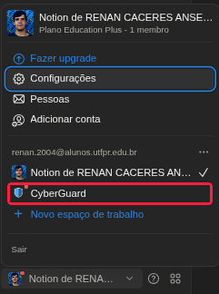
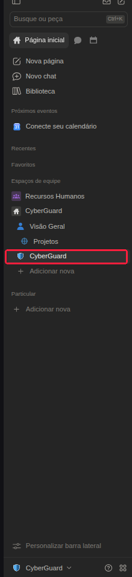

# 🛡️ Tutorial: Como Acessar o Workspace do CyberGuard no Notion

Muitos integrantes, ao criarem ou acessarem sua conta no Notion, caem inicialmente em seu **espaço pessoal** e ficam em dúvida sobre como encontrar o CyberGuard sem depender do link direto enviado pelo bot.

Siga os **3 passos simples** abaixo para alternar para o Workspace oficial a qualquer momento:

---

## Passo 1: Abrir o Menu de Espaços de Trabalho

No canto **inferior esquerdo** da barra lateral do Notion, localize o botão com a sua foto/avatar e o nome do seu espaço atual (geralmente *"Notion de SeuNome..."*).

👉 **Clique nesse botão** para expandir o menu de contas e espaços:

---

## Passo 2: Selecionar o Workspace do CyberGuard

No menu suspenso que se abrir, você verá a lista de todos os espaços de trabalho vinculados ao seu e-mail.

👉 Localize e clique em **CyberGuard** (ao lado do ícone de escudo azul):

> [!NOTE]
> Se o item **CyberGuard** não aparecer na sua lista, certifique-se de que está logado no Notion com o **mesmo e-mail** cadastrado no onboarding do bot.

---

## Passo 3: Abrir a Página Central do CyberGuard

Assim que o Notion alternar para o Workspace do CyberGuard, a barra lateral exibirá toda a estrutura do projeto.

👉 Em **Espaços de equipe**, clique na página **CyberGuard** (com o ícone do escudo azul):

Pronto! Você estará diretamente na **página inicial oficial do CyberGuard**, onde encontrará:
* Murais de avisos e comunicados;
* Projetos e tarefas ativas da sua equipe;
* Documentos, sprints e materiais de apoio.

---

## 💡 Dicas de Produtividade

> [!TIP] **Fixe nos Favoritos do Notion:**
> Passe o cursor do mouse sobre a página **CyberGuard** na barra lateral e clique na estrelinha ⭐ (*Adicionar aos favoritos*). A página ficará sempre no topo da sua lista lateral para acesso imediato.

> [!TIP] **Favorito no Navegador:**
> Quando estiver na página do CyberGuard no navegador, pressione `Ctrl + D` para salvá-la na sua barra de favoritos.
