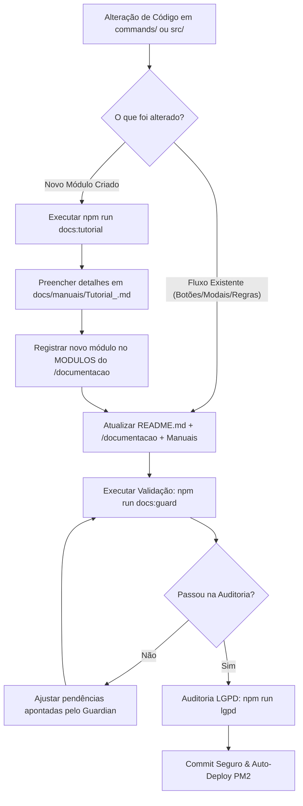

# 📘 Tutorial Oficial • Doc & Flow Guardian
**CyberGuard Bot • Sistema de Governança Contínua de Fluxos e Documentação**

> **Objetivo:** Garantir que toda e qualquer alteração de fluxo na aplicação reflita instantaneamente nas documentações, e que novos módulos recebam automaticamente manuais e tutoriais padronizados.  
> **Público-alvo:** Desenvolvedores, Mantenedores do Bot, Liderança Técnica e Agentes de IA  
> **Comandos Principais:** `npm run docs:guard`, `npm run docs:status`, `npm run docs:tutorial`

---

## 🎯 1. Visão Geral do Doc & Flow Guardian

O **Doc & Flow Guardian** é o subsistema de governança técnica do CyberGuard Bot responsável por impedir que a documentação fique defasada em relação ao código-fonte da aplicação.

Historicamente, bots do Discord e ecossistemas modulares sofrem com rotinas e fluxos que mudam (novos botões, modais, permissões ou etapas) sem que manuais, arquivos `README.md` e comandos de ajuda reflitam essa nova realidade.

O Guardian atua em duas frentes complementares:
1. **Auditoria Reativa & Preventiva de Fluxos:** Intercepta alterações em `commands/` e `src/` e exige que `README.md`, `commands/documentacao/documentacaoCommand.js` e manuais sejam atualizados em sincronia.
2. **Fábrica de Tutoriais para Novos Módulos:** Ao criar uma nova pasta em `commands/` ou novo serviço em `src/`, o agente gera um tutorial completo, cadastra o módulo no catálogo interativo do `/documentacao` e adiciona as seções técnicas necessárias.

---

## 👥 2. Matriz de Responsabilidades & Escopos

| Papel / Agente | Responsabilidade no Guardian | Ações Permitidas |
| :--- | :--- | :--- |
| **Agente de IA / Antigravity** | Monitoramento automático de diffs e atualização documental | Atualiza `README`, `MODULOS`, manuais e scripts de deploy |
| **Desenvolvedor / Mantenedor** | Validação antes de commits e criação de novos módulos | `npm run docs:guard`, `npm run docs:tutorial`, `npm run lgpd` |
| **Liderança / Administrador** | Consulta do status de cobertura de documentação do bot | `npm run docs:status` |

---

## 🚀 3. Fluxo Operacional de Governança



---

## 🛠️ 4. Guia Rápido de Comandos CLI

### 1. Auditoria de Cobertura (`npm run docs:guard`)
Verifica se há comandos sem módulo correspondente ou se arquivos de lógica foram alterados sem atualização de documentação:
```bash
npm run docs:guard
# ou: node scripts/doc-flow-guardian.js --check
```

### 2. Painel de Status de Cobertura (`npm run docs:status`)
Exibe em tempo real o mapa de todos os comandos, módulos registrados em `/documentacao` e presença de seus respectivos manuais em PDF/Markdown:
```bash
npm run docs:status
# ou: node scripts/doc-flow-guardian.js --status
```

### 3. Geração de Tutorial para Novo Módulo (`npm run docs:tutorial`)
Cria o esqueleto completo do tutorial e exibe o snippet para inclusão no seletor do Discord:
```bash
npm run docs:tutorial <id_do_modulo> -- --titulo "Título do Módulo" --subtitulo "Descrição sucinta" --comandos "/cmd1,/cmd2"
```

---

## 🔒 5. Salvaguardas LGPD & Integridade

O Doc & Flow Guardian opera em estrita consonância com a **LGPD (Lei nº 13.709/2018)**:
1. **Anonimização nos Tutoriais:** Exemplos de protocolos devem usar estritamente `#DECL-0000000-1234` ou `#TERMO-0000000-1234`.
2. **Sem Credenciais ou IDs Hardcoded:** Jamais incluir tokens, e-mails reais ou Discord Snowflake IDs em manuais ou exemplos.
3. **Travamento no Stop Hook:** O hook [`.agents/hooks/stop-lgpd-deploy.js`](file:///home/renan/Documentos/GitHub/cyberguard-bot/.agents/hooks/stop-lgpd-deploy.js) bloqueia automaticamente encerramentos de turnos se houver violações ou módulos pendentes de documentação.

---

*Manual oficial do subsistema Doc & Flow Guardian do CyberGuard Bot.*
