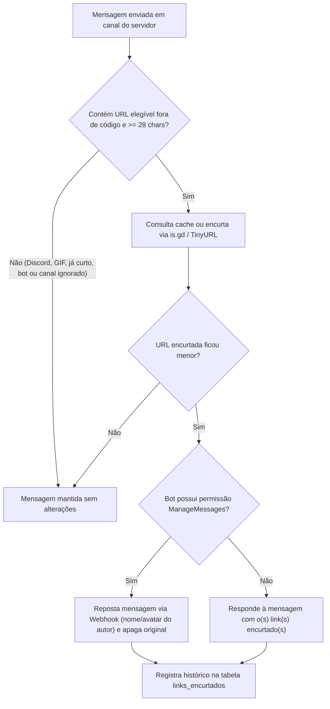

# 📘 Tutorial Oficial • 🔗 Encurtador de Links
**CyberGuard Bot • Guia Operacional e Instruções de Uso**

> **Objetivo:** Encurtar automaticamente links longos postados nos canais do servidor e disponibilizar o módulo dedicado `/encurtar` (via `is.gd` com fallback automático para `TinyURL`).  
> **Público-alvo:** Membros, Líderes de Setor, Recursos Humanos e Administradores  
> **Comandos Principais:** `/encurtar link`, `/encurtar historico`, `/encurtar status`, `/encurtar configurar`

---

## 🎯 1. Visão Geral do Módulo

O módulo **🔗 Encurtador de Links** mantém os canais do Discord limpos e legíveis, substituindo URLs extensas automaticamente e oferecendo ferramentas manuais sob demanda.

### Recursos Principais:
- **Encurtamento Automático no Chat (`src/encurtador.js`):** Sempre que um integrante envia um link longo no servidor, o bot gera a URL curta, reposta a mensagem preservando o nome, avatar (via Webhook) e anexos do autor, e remove a mensagem original.
- **Proteções Inteligentes:** Ignora mensagens de bots/webhooks, DMs, blocos de código (`` `...` `` e `` ```...``` ``), links do próprio Discord (`discord.com`, `discord.gg`, `cdn.discordapp.com`), GIFs/mídias (`tenor.com`, `giphy.com`), links já encurtados (`is.gd`, `bit.ly`, `tinyurl.com`, `youtu.be`, etc.) e URLs abaixo do tamanho mínimo configurado (`28` caracteres por padrão).
- **Alta Disponibilidade:** Utiliza a API pública do **is.gd** (com suporte a apelido personalizado e cache em PostgreSQL/memória) e fallback automático para **TinyURL**.
- **Comando Dedicado `/encurtar`:** Permite encurtar links manualmente (com opção de apelido e exibição privada ou pública), consultar histórico e gerenciar configurações em tempo real.

---

## 👥 2. Perfis de Acesso e Permissões

| Nível / Cargo | Permissões no Módulo | Escopo de Visibilidade |
| :--- | :--- | :--- |
| **Membro / Voluntário** | Encurtamento automático no chat, `/encurtar link`, `/encurtar status` e `/encurtar historico` (próprio) | Efêmero por padrão (ou público opcional em `/encurtar link`) |
| **Líder de Setor / RH / Admin** | Todas as anteriores + `/encurtar historico escopo:servidor` e `/encurtar configurar` | Global do servidor |

---

## 🚀 3. Fluxo Operacional Passo a Passo



### Fluxo Manual (`/encurtar link`):
1. Execute `/encurtar link` informando o parâmetro obrigatório `url`.
2. Opcionalmente informe `apelido` (`5 a 30` caracteres alfanuméricos ou `_`) para criar um link personalizado no `is.gd`.
3. Por padrão, o resultado é enviado de forma **efêmera** (privada). Caso deseje exibir no canal, defina `publico: true`.

---

## 🛠️ 4. Lista de Comandos e Parâmetros

| Comando | Parâmetros | Descrição do Fluxo |
| :--- | :--- | :--- |
| `/encurtar link` | `url` *(obrigatório)*, `apelido` *(opcional)*, `publico` *(opcional)* | Valida e encurta uma URL manualmente via `is.gd` (fallback `TinyURL`), exibindo a economia de caracteres. |
| `/encurtar historico` | `escopo` *(opcional: `meus` \| `servidor`)* | Lista de forma efêmera os últimos 10 links encurtados e os totais (`Automático` vs `Comando`). |
| `/encurtar status` | N/A | Exibe se o encurtador automático está ativo, tamanho mínimo, canais/domínios ignorados e totais. |
| `/encurtar configurar` | `auto` *(opcional)*, `ignorar_canal` *(opcional)*, `canal` *(opcional)* | **[Liderança/RH/Admin]** Liga/desliga o encurtador automático ou adiciona/remove um canal da lista de exceções. |

---

## 🔒 5. Segurança, Privacidade e LGPD

1. **Bloqueio Anti-SSRF / Rede Interna:** URLs que não sejam `http://` ou `https://`, ou que apontem para `localhost`, `.local`, `.internal` ou faixas de IP privadas/loopback (`127.0.0.0/8`, `10.0.0.0/8`, `172.16.0.0/12`, `192.168.0.0/16`, `169.254.0.0/16`) são rejeitadas automaticamente.
2. **Prevenção de Abuso de Menções:** Ao repostar mensagens via Webhook, o bot restringe menções (`allowedMentions`) para impedir disparos indevidos de `@everyone`, `@here` ou cargos.
3. **Minimização e Privacidade:** O módulo armazena na tabela `links_encurtados` apenas `discord_id`, `canal_id`, URL original, URL encurtada, provedor e origem (`auto` ou `comando`), sem coletar dados cadastrais sensíveis.
4. **Respeito a DMs e Canais Sensíveis:** Mensagens Diretas (DM) nunca passam pelo encurtador automático para preservar fluxos de onboarding, termos e suporte.

---

*Documento gerado e mantido pelo CyberGuard Doc & Flow Guardian.*
